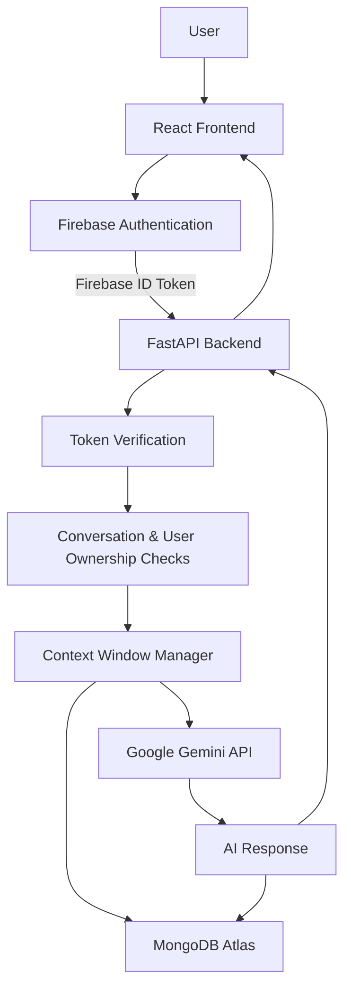

# 🧠 ContextMind AI

### An Intelligent, Context-Aware AI Chatbot Powered by Google Gemini

<p align="center">
  <a href="https://contextmind-ai.vercel.app/">
    
  </a>
  <a href="https://contextmind-ai-backend.onrender.com/docs">
    
  </a>
</p>

<p align="center">
  
  
  
  
  
  
</p>

---

## 📌 Overview

**ContextMind AI** is a full-stack, context-aware AI chatbot designed to provide meaningful multi-turn conversations while maintaining conversational memory.

Unlike a basic chatbot that treats every message independently, ContextMind AI maintains conversation history, retrieves relevant previous messages, and manages the context window to help the AI generate more contextually relevant responses.

Powered by Google's Gemini API, the application combines a React frontend, FastAPI backend, MongoDB Atlas persistence, and Firebase Google Authentication.

**Live Application:** https://contextmind-ai.vercel.app/

**Backend API:** https://contextmind-ai-backend.onrender.com

---

## ✨ Key Features

### 🧠 Context-Aware Conversational Memory
- Maintains conversation history across multiple turns.
- Retrieves previous messages to preserve conversational context.
- Implements a configurable sliding context window using `MAX_CONTEXT_MESSAGES`.
- Stores conversations and messages persistently in MongoDB Atlas.

### 🔐 Secure Google Authentication
- Google Sign-In using Firebase Authentication.
- Firebase ID token verification on the backend.
- Protected API endpoints.
- User-level conversation ownership and isolation.
- Users can access only their own conversations.

### 💬 Conversation Management
- Automatically generates concise conversation titles from the initial prompt.
- Loads previous conversations from the database.
- Supports retrieving complete conversation history.
- Supports renaming conversations.
- Cascade deletion removes a conversation and its associated messages.

### ⚡ Modern Chat Interface
- Responsive dark-themed user interface.
- Built using React 19 and Tailwind CSS v4.
- Real-time typing/loading indicators.
- Message error handling.
- Lucide icons and interactive UI components.

### 🛠️ Developer Experience
- FastAPI interactive Swagger documentation.
- Modular backend architecture.
- Environment-based configuration.
- MongoDB indexes for efficient conversation retrieval.

---

## 🏗️ System Architecture



### Architecture Components

| Component | Technology | Responsibility |
|---|---|---|
| Frontend | React 19 | User interface |
| Build Tool | Vite | Frontend development and bundling |
| Styling | Tailwind CSS v4 | Responsive UI |
| Backend | FastAPI | REST API and application logic |
| AI Integration | Google GenAI SDK | Gemini model integration |
| AI Model | Google Gemini (`gemini-3.5-flash-lite`) | Response generation |
| Database | MongoDB Atlas | Persistent conversation storage |
| Authentication | Firebase Auth | Google Sign-In |
| Token Verification | google-auth | Firebase ID token verification |
| Deployment | Vercel + Render | Frontend and backend hosting |

---

## 🧠 How Context Memory Works

ContextMind AI uses MongoDB Atlas to maintain persistent conversation history.

The application follows this workflow:

1. A user signs in using Google Authentication.
2. The frontend obtains a Firebase ID token.
3. The backend verifies the token and identifies the user.
4. The user sends a message, optionally with an existing conversation ID.
5. The backend retrieves the conversation history from MongoDB.
6. The context manager selects the most recent messages within the configured context limit.
7. The selected conversation history and latest user message are sent to Gemini.
8. Gemini generates a context-aware response.
9. Both the user message and AI response are persisted in MongoDB.
10. The response is returned to the frontend.

### Context Window Configuration

The number of messages retained for model input can be configured using:

```env
MAX_CONTEXT_MESSAGES=10
```

This provides a sliding-window approach to managing conversational context.

> Note: The context window limits the history sent to the model. The complete conversation remains stored in MongoDB.

---

## 🔒 Authentication and Data Isolation

ContextMind AI uses Firebase Authentication with Google Sign-In.

Every protected backend request must include:

```http
Authorization: Bearer <Firebase_ID_Token>
```

The FastAPI backend verifies the Firebase ID token before processing protected requests.

Conversation ownership is enforced using the authenticated user's ID.

This ensures that:
- Users can retrieve only their own conversations.
- Users cannot access another user's messages.
- Conversation updates and deletion are restricted to the owner.
- Unauthenticated requests to protected endpoints are rejected.

---

## 📁 Project Structure

```text
contextmind-ai/
│
├── backend/
│   ├── app/
│   │   ├── routes/
│   │   │   └── chat.py
│   │   ├── auth.py
│   │   ├── config.py
│   │   ├── database.py
│   │   ├── gemini.py
│   │   ├── main.py
│   │   └── memory.py
│   │
│   ├── test_context_window.py
│   ├── test_gemini.py
│   ├── testdb.py
│   └── testmemory.py
│
├── frontend/
│   ├── src/
│   │   ├── assets/
│   │   ├── services/
│   │   │   ├── api.js
│   │   │   └── auth.js
│   │   ├── App.jsx
│   │   ├── firebase.js
│   │   └── main.jsx
│   │
│   ├── .env.example
│   ├── package.json
│   └── vite.config.js
│
├── .env.example
├── .gitignore
├── Procfile
├── requirements.txt
└── README.md
```

---

## 🖥️ Screenshots

Add actual screenshots of your deployed application in `frontend/src/assets/screenshots/` or another suitable screenshots directory.

Suggested screenshots:

| Screenshot | Description |
|---|---|
| `login.png` | Google authentication screen |
| `chat-interface.png` | Main ContextMind AI chat interface |
| `conversation-history.png` | Recent conversations sidebar |
| `multi-turn-memory.png` | Multi-turn context demonstration |

Once added, embed them here:

```markdown
### Login


### Chat Interface


### Conversation History


### Multi-turn Memory

```

---

## ⚙️ Getting Started

Follow these steps to run ContextMind AI locally.

### 1. Prerequisites

Make sure you have:

- Python 3.10+
- Node.js 18+
- npm
- MongoDB Atlas account
- Google Gemini API key
- Firebase project with Google Authentication enabled

### 2. Clone the Repository

```bash
git clone https://github.com/JaganRamadugu/contextmind-ai.git

cd contextmind-ai
```

### 3. Backend Setup

Create and activate a Python virtual environment.

**Windows PowerShell:**

```powershell
python -m venv venv
.\venv\Scripts\Activate.ps1
```

**Linux / macOS:**

```bash
python3 -m venv venv
source venv/bin/activate
```

Install the dependencies:

```bash
pip install -r requirements.txt
```

Create a `.env` file in the project root:

```env
GEMINI_API_KEY=your_gemini_api_key
GEMINI_MODEL=gemini-3.5-flash-lite

MONGODB_URI=your_mongodb_atlas_connection_string
DATABASE_NAME=contextmind_db

MAX_CONTEXT_MESSAGES=10
```

Configure any additional backend environment variables required by your Firebase token-verification implementation.

### 4. Frontend Setup

Navigate into the frontend directory:

```bash
cd frontend
npm install
```

Create `frontend/.env`:

```env
VITE_FIREBASE_API_KEY=your_firebase_api_key
VITE_FIREBASE_AUTH_DOMAIN=your_project.firebaseapp.com
VITE_FIREBASE_PROJECT_ID=your_project_id
VITE_FIREBASE_STORAGE_BUCKET=your_storage_bucket
VITE_FIREBASE_MESSAGING_SENDER_ID=your_sender_id
VITE_FIREBASE_APP_ID=your_app_id

VITE_API_URL=http://localhost:8000/api
```

Start the development server:

```bash
npm run dev
```

Frontend URL:

```text
http://localhost:5173
```

### 5. Start the Backend

From the project root, activate your virtual environment and run:

```bash
uvicorn app.main:app --reload --app-dir backend --port 8000
```

Backend URL:

```text
http://127.0.0.1:8000
```

Swagger API documentation:

```text
http://127.0.0.1:8000/docs
```

---

## 📡 API Reference

Protected endpoints require a valid Firebase ID token in the Authorization header.

| Method | Endpoint | Description | Authentication |
|---|---|---|---|
| GET | `/` | Backend health check | No |
| POST | `/api/chat` | Create a conversation or send a message | Yes |
| GET | `/api/conversations` | Retrieve the user's conversations | Yes |
| GET | `/api/conversations/{id}/messages` | Retrieve conversation messages | Yes |
| PATCH | `/api/conversations/{id}` | Rename an owned conversation | Yes |
| DELETE | `/api/conversations/{id}` | Delete a conversation and its messages | Yes |

Interactive API documentation is available at:

https://contextmind-ai-backend.onrender.com/docs

---

## 🧪 Testing

The backend includes scripts for testing important application components.

Run the following commands from the project root:

```bash
# Test MongoDB connection
python backend/testdb.py

# Test Gemini API connectivity
python backend/test_gemini.py

# Test conversation storage and retrieval
python backend/testmemory.py

# Test context window management
python backend/test_context_window.py
```

---

## ☁️ Deployment

ContextMind AI is deployed using the following services:

| Service | Platform | Deployment |
|---|---|---|
| Frontend | Vercel | React + Vite |
| Backend | Render | FastAPI |
| Database | MongoDB Atlas | Conversation persistence |
| Authentication | Firebase | Google Sign-In |
| AI API | Google Gemini | LLM response generation |

### Live Links

- **Application:** https://contextmind-ai.vercel.app/
- **Backend:** https://contextmind-ai-backend.onrender.com
- **Swagger API Docs:** https://contextmind-ai-backend.onrender.com/docs
- **GitHub Repository:** https://github.com/JaganRamadugu/contextmind-ai

---

## 🔮 Future Improvements

Potential directions for further development:

- Streaming AI responses.
- Conversation search and filtering.
- More advanced summarization-based context management.
- Export conversations.
- Rate limiting and usage monitoring.
- Automated backend and frontend tests.
- Additional LLM provider support.

---

## 🎯 What I Learned

Building ContextMind AI helped me work through practical full-stack AI engineering concepts, including:

- Integrating a real LLM API into a web application.
- Designing REST APIs using FastAPI.
- Managing multi-turn conversational context.
- Implementing persistent memory using MongoDB.
- Integrating Firebase Authentication.
- Securing backend endpoints using token verification.
- Enforcing user-level data isolation.
- Deploying a full-stack application to cloud platforms.

---

## 👨‍💻 Author

**Jagan Ramadugu**

B.Tech — Computer Science and Engineering (AI & ML)

- GitHub: [@JaganRamadugu](https://github.com/JaganRamadugu)
- LinkedIn: https://www.linkedin.com/in/jagan-ramadugu-33666031a/

---

## 📄 License

This project was created as part of an internship assessment.

All rights reserved.

---

<p align="center">
  <b>Built with ❤️ by Jagan Ramadugu</b>
  <br/>
  <i>Making AI conversations more contextual, persistent, and meaningful.</i>
</p>
